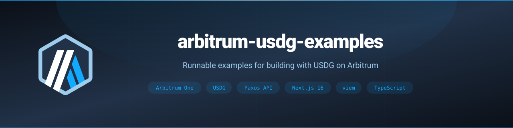

<!-- Banner -->
<p align="center">
  
</p>

<!-- Badges -->
<p align="center">
  <a href="LICENSE"></a>
  <a href="https://nodejs.org/"></a>
  <a href="https://www.typescriptlang.org/"></a>
  <a href="https://nextjs.org/"></a>
  <a href="https://viem.sh/"></a>
  <a href="https://arbitrum.io/products/usdg-on-arbitrum"></a>
  <a href="#contributing"></a>
</p>

<!-- One-liner + nav -->
<p align="center">
  <strong>Runnable examples for building with USDG, the Global Dollar issued by Paxos, on Arbitrum One.</strong>
  <br>
  <a href="https://arbitrum.io/products/usdg-on-arbitrum">USDG on Arbitrum</a> · <a href="#quick-start">Quick Start</a> · <a href="https://github.com/hummusonrails/arbitrum-usdg-examples/issues">Report a Bug</a>
</p>

> [!IMPORTANT]
> These are demonstration apps and unaudited example code. Use them to learn the integration patterns, not to manage real funds as they are.

## What it does

- **Shows** the four ways a business can put USDG to work on Arbitrum, one runnable example per path.
- **Runs** every example locally with one command, on forks of Arbitrum One (and Ethereum, for cross chain moves) with local stand ins for outside services, so you need no accounts or funds to explore.
- **Connects** to the Paxos sandbox and Arbitrum Sepolia when you are ready to try the real APIs.
- **Uses** the real USDG contract on Arbitrum, its built in rewards engine, the Paxos LayerZero OFT, and the documented Paxos v2 API, with a typed client generated from the Paxos OpenAPI spec.
- **Proves** each flow end to end with tests that drive the running app, the chain, and the local stand ins together.

## Examples

| Path                                                          | What you build                                                                                                                                                                                                      | Status      |
| :------------------------------------------------------------ | :------------------------------------------------------------------------------------------------------------------------------------------------------------------------------------------------------------------ | :---------- |
| [Sample business treasury](examples/sample-business-treasury) | A simulated treasury app for a fictional company: mint USD into USDG, redeem USDG back to the bank, keep a wallet inside a balance band, and reconcile every Paxos record against Arbitrum                          | Available   |
| [Sample fintech earn](examples/sample-fintech-earn)           | A simulated fintech app for a fictional company: let customers supply USDG to third party vaults on Arbitrum, keep a per customer ledger that reconciles against the chain, and share vault incentives fairly       | Available   |
| Perp DEX margin                                               | Accept USDG as margin in a vault registered for rewards through the propose and accept flow                                                                                                                         | Coming soon |
| [Sample spot DEX](examples/sample-spot-dex)                   | A simulated spot DEX for a fictional company: quote pools in USDG, register pool contracts for USDG rewards through propose and accept, route them to liquidity providers, and move USDG cross chain with LayerZero | Available   |

<!-- BEGIN building-with-usdg: generated by pnpm guide:readme -->

## Building with USDG on Arbitrum

USDG, the Global Dollar issued by Paxos, is minted natively on Arbitrum One and backed 1:1. Use one dollar across trading, lending, payments, and treasury, with ecosystem programs available to eligible businesses that build with it. [Learn about USDG on Arbitrum](https://arbitrum.io/products/usdg-on-arbitrum) or [talk to the Arbitrum team](https://arbitrum.io/products/usdg-on-arbitrum#contact-form).

### Ways to build with USDG

- **Embedded earn:** Connect your app to third party USDG vaults and offer customers a simple earn experience.
- **Trading and collateral:** Let your users put USDG to work as margin for perpetual markets.
- **Markets and settlement:** Use USDG as a quote and settlement currency across spot and perpetual markets, DEX pools, and supported RWA issuance, minting, and redemption flows.
- **Treasury operations:** Hold reserve balances, collect protocol fees, run payroll, and support cross border payments in one dollar.

### Why Arbitrum is a great home for USDG

- **Native on Arbitrum One:** Paxos mints USDG directly on Arbitrum One. One Paxos API call turns US dollars into USDG delivered to any Arbitrum wallet, and redeems it back to a bank 1:1.
- **Programmable dollars:** USDG supports signed transfers (EIP-3009) and permits (EIP-2612), including batches of signed transfers in one transaction. That opens gasless checkouts, scheduled payouts, and payroll runs signed once and settled together.
- **Rewards built into the token:** The Global Dollar Network rewards engine lives in the USDG contract itself. Eligible partners can register wallets into payout groups, and smart contracts such as vaults and pools can join through an onchain propose and accept flow.
- **Connected across chains:** USDG moves between Arbitrum and Ethereum through LayerZero, and Paxos can deliver it on many networks from one balance.
- **Already live in DeFi:** USDG is live in leading Arbitrum protocols, including GMX markets and the GMX Dollar Vault, Morpho vaults, Fluid, and Uniswap v4. Supplying USDG to vaults is incentivized through [DRIP](https://arbitrumdrip.com/opportunities), Arbitrum's DeFi Renaissance Incentive Program.
- **Built for automation:** Rules mint USDG automatically when a wire arrives, and webhooks plus an events API let your backend react to every mint, deposit, and payout.

### Start building

1. **Run an example:** pick one from the table above and start it in mock mode, no accounts needed.
2. **Try the Paxos sandbox:** Create a [sandbox account](https://dashboard.sandbox.paxos.com). Its Arbitrum network runs on Arbitrum Sepolia, with test USDG from the [Paxos faucet](https://faucet.paxos.com).
3. **Read the USDG guides:** The [Paxos USDG docs](https://docs.paxos.com/guides/stablecoin/usdg) cover minting, redeeming, rewards, and webhooks.
4. **Talk to the Arbitrum team:** Tell us where USDG fits in your roadmap and we'll help find the right market, liquidity, collateral, earn, or partnership path. [Get in touch](https://arbitrum.io/products/usdg-on-arbitrum#contact-form)

<sub>USDG is issued by Paxos on behalf of the Global Dollar Network. USDG on Arbitrum is an ecosystem program offered by the Arbitrum Foundation to eligible businesses under a separate written agreement. Holding USDG does not earn rewards; third party products such as vaults offer rewards independently under their own terms.</sub>
<!-- END building-with-usdg -->

## Quick Start

```bash
git clone https://github.com/hummusonrails/arbitrum-usdg-examples.git
cd arbitrum-usdg-examples
pnpm install
pnpm --filter sample-business-treasury dev:mock   # or: sample-fintech-earn dev:fork, sample-spot-dex dev:fork
```

Open the address it prints (http://127.0.0.1:3000). Each example starts a fresh fork of Arbitrum One, its local stand ins, and the app. A short tour walks you through each action the first time.

## Stack

| Layer               | Tool                             | Notes                                                             |
| :------------------ | :------------------------------- | :---------------------------------------------------------------- |
| Chain               | Arbitrum One, Arbitrum Sepolia   | USDG `0x004B506865409877C9fA29bfb1ebA929984B9bbC` on Arbitrum One |
| Stablecoin platform | Paxos v2 API                     | Orchestrations, deposit addresses, events, and webhooks           |
| Vaults              | Morpho Vault V2, GMX GLV, Merkl  | Third party USDG vaults and their incentives on Arbitrum One      |
| Cross chain         | LayerZero, Paxos USDG OFT        | USDG between Ethereum and Arbitrum One                            |
| Contracts           | Solidity, Foundry, OpenZeppelin  | The sample spot DEX pool and its tests                            |
| App                 | Next.js 16, React 19, Tailwind 4 | Pages and server routes in one app                                |
| Chain client        | viem 2                           | Reads, signed transfers, and log decoding                         |
| Storage             | SQLite (`node:sqlite`)           | Built into Node, no extra service                                 |
| Local chain         | Foundry Anvil                    | Forks Arbitrum One and Ethereum for mock mode and tests           |

<details>
<summary><strong>Prerequisites</strong></summary>

- [Node.js](https://nodejs.org/) 22.13 or newer
- [pnpm](https://pnpm.io/installation) 10
- [Foundry](https://book.getfoundry.sh/getting-started/installation) for `anvil` and `forge`
- For sandbox mode: a [Paxos sandbox account](https://dashboard.sandbox.paxos.com) and test ETH on Arbitrum Sepolia

</details>

## Project structure

```text
arbitrum-usdg-examples/
├── packages/
│   ├── usdg/              USDG addresses, ABI, exact amount helpers, wallet health
│   ├── paxos-client/      Typed Paxos v2 client generated from the OpenAPI spec
│   └── usdg-guide/        Building with USDG on Arbitrum content, shown in every example and this README
└── examples/
    ├── sample-business-treasury/
        ├── app/           Next.js app, treasury server logic, setup scripts
        ├── mock-paxos/    Local Paxos stand in that moves real USDG on a fork
        └── e2e/           End to end tests for the whole stack
    └── sample-fintech-earn/
        ├── app/           Next.js app: customer view, operator console, earn server logic
        ├── fork-services/ Local GMX keeper and Merkl stand in for the fork
        └── e2e/           End to end tests for the whole stack
    └── sample-spot-dex/
        ├── contracts/     The USDG quoted pool contract and its Foundry tests
        ├── app/           Next.js app: trader view, operator console, DEX server logic
        ├── fork-services/ Payout group stand in and LayerZero relay for the forks
        └── e2e/           End to end tests for the whole stack
```

## Testing

```bash
pnpm --filter sample-business-treasury-e2e test
pnpm --filter sample-fintech-earn-e2e test
pnpm --filter sample-spot-dex-e2e test
```

Each suite builds its app, starts fresh forks with its local stand ins, and drives the app through its API while checking balances on chain: mints, redeems, the auto mint rule, restarts, and failure handling for the treasury; vault deposits and withdrawals, GMX keeper settlement, reward claims, and reconciliation for earn; swaps, propose and accept, reward routing to LPs, transfers both ways, and restarts mid transfer for the spot DEX.

## Learn more

- [USDG on Arbitrum](https://arbitrum.io/products/usdg-on-arbitrum)
- [USDG developer guide from Paxos](https://docs.paxos.com/guides/stablecoin/usdg)
- [Paxos orchestrations](https://docs.paxos.com/guides/developer/orchestrations/mint)
- [USDG vaults with DRIP incentives](https://arbitrumdrip.com/opportunities)
- [USDG rewards engine contracts from Paxos](https://github.com/paxosglobal/paxos-token-contracts/blob/master/docs/CLAIMABLE_REWARDS_README.md)
- [USDG OFT addresses](https://docs.paxos.com/guides/stablecoin/usdg/mainnet)

## Contributing

Found a bug or want to add an example? [Open an issue](https://github.com/hummusonrails/arbitrum-usdg-examples/issues) or send a pull request.

## License

[MIT](LICENSE)
