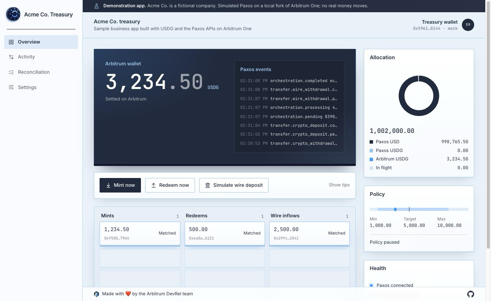
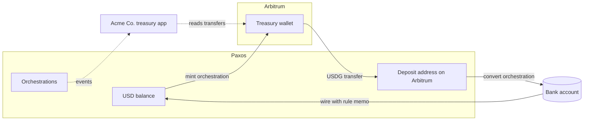

# Sample business treasury

A simulated treasury app for a fictional company, Acme Co., built with USDG and the Paxos APIs on Arbitrum. It shows how a business that holds dollars can mint USD into USDG, redeem USDG back to its bank account, keep its wallet inside a balance band, and reconcile every Paxos record against the matching Arbitrum transaction.

It is a sample app for builders. It is not a view of the Arbitrum treasury, and it is not a USDG data dashboard.



> [!IMPORTANT]
> This is a demonstration app and unaudited example code. Use it to learn the integration, not to manage real funds as it is.

## Who it is for

Developers at fintechs, protocols, and businesses that move dollars: treasury teams, payment flows, protocol fee collection. After running it you will know how to:

- **Mint** USD into USDG delivered straight to a wallet on Arbitrum, on demand or automatically when a bank wire arrives.
- **Redeem** USDG from Arbitrum back to USD in a bank account.
- **React** to Paxos events reliably with webhooks and polling.
- **Reconcile** Paxos records against USDG transfers on Arbitrum.

## Run it locally

```bash
pnpm install
pnpm --filter sample-business-treasury dev:mock
```

Mock mode needs no accounts. It starts:

- a fresh Anvil fork of Arbitrum One, so balances and transfers use the real USDG contract
- a local stand in for the Paxos API that sends real USDG on the fork
- the setup step, which prepares the wallet, the deposit address, the auto mint rule, and a bank account
- the app at http://127.0.0.1:3000

The policy starts paused so you can try each action by hand. Hover any action to see what it does and which API calls it makes.

## How it works



### Minting

One call converts USD in your Paxos account into USDG and sends it to your wallet on Arbitrum:

```ts
await paxos.createOrchestration({
    ref_id: refId,
    source_asset: 'USD',
    source_amount: '2500',
    destination_asset: 'USDG',
    source: { profile: { profile_id: profileId } },
    destination: { crypto: { address: wallet, network: 'ARBITRUM_ONE' } },
});
```

Every write carries a `ref_id`. Paxos answers a repeated `ref_id` with `409` and the existing orchestration, which the app picks up, so a retry after a crash never mints twice.

### The auto mint rule

Setup creates an orchestration rule with a wire source and your wallet as the destination. Paxos gives the rule a memo; any wire that arrives with that memo becomes USDG in your wallet with no code in the loop. In the sandbox, **Simulate wire deposit** sends a test wire with the memo.

### Redeeming

Redeeming has two steps:

1. The wallet sends USDG to your Paxos deposit address on Arbitrum.
2. When the deposit lands, a USDG to USD orchestration pays your bank account.

Paxos asks who sent a deposit from a new address. The treasury wallet belongs to your business, so the app answers with your organization:

```ts
await paxos.updateCryptoDeposit(deposit.id, {
    identity_id: identityId,
    originator_address_info: {
        institution_info: { institution_name: institutionName },
    },
});
```

The app signs the Arbitrum transfer and stores it before broadcasting. After a restart it rebroadcasts the same signed transaction, so USDG never leaves the wallet twice.

### Registering the treasury wallet

Setup registers the wallet as a destination your business owns, with travel rule details:

```ts
await paxos.putCryptoDestinationAddress({
    crypto_network: 'ARBITRUM_ONE',
    address: wallet,
    bookmarked_status: true,
    travelrule_metadata: { beneficiary: { self: true }, custodian_type: 'PRIVATE' },
});
```

It also proves the business controls the wallet by signing the message Paxos returns from `POST /v2/addresses/verifications`.

### The treasury policy

The loop keeps the wallet between a minimum and a maximum. Below the minimum it mints back to the target; above the maximum it redeems the excess. USDG on its way to the bank counts toward the balance, and the policy waits while any action is in progress or needs attention, so it never acts twice on the same gap.

### Events

Paxos webhooks carry only an event id and type, so the app treats each one as a hint: it records the id, fetches the event and the current orchestration or transfer from the API, and acts on that. It also polls `GET /v2/events`, so it works without a public URL and catches anything a webhook missed. Each event is applied once, however it arrives.

### Reconciliation

Every mint, redeem, and wire inflow becomes a ledger row. The app reads the Arbitrum receipt, decodes the USDG `Transfer` log, and compares recipient and amount with the Paxos transfer record. Rows end as matched, mismatch, stuck, or failed, and the board on the overview lights each match as it happens.

## Run it against the Paxos sandbox

1. Create a [Paxos sandbox account](https://dashboard.sandbox.paxos.com) and API credentials. Add your machine's public IP to the credential's allowed IPs.
2. Grant these scopes: `events:read_event`, `funding:read_profile`, `orchestration:read_orchestration`, `orchestration:write_orchestration`, `orchestration:read_orchestration_rule`, `orchestration:write_orchestration_rule`, `transfer:read_deposit_address`, `transfer:write_deposit_address`, `transfer:read_fiat_account`, `transfer:read_fiat_deposit_instructions`, `transfer:read_transfer`, `transfer:write_crypto_destination_address`, `transfer:write_sandbox_fiat_deposit`. For deposit confirmation, ownership proofs, and bank accounts also add `transfer:update_crypto_deposit`, `transfer:read_crypto_destination_address`, `transfer:write_fiat_account`, `address:read_ownership_proofs`, and `address:write_ownership_proofs`.
3. Fund your sandbox profile with USD from the Dashboard.
4. Create a wallet for the treasury and send it test ETH on Arbitrum Sepolia. Test USDG is available from the [Paxos faucet](https://faucet.paxos.com).
5. Copy `.env.example` to `.env` and fill it in.
6. Run setup, then the app:

```bash
cd examples/sample-business-treasury/app
pnpm run setup
pnpm dev
```

To receive webhooks, add one in the Paxos Dashboard pointing at `https://<your host>/api/webhooks/paxos` with the header `x-api-key` set to `WEBHOOK_API_KEY`. Without a webhook the app polls for events.

## Configuration

| Variable                                      | Purpose                                                                           |
| :-------------------------------------------- | :-------------------------------------------------------------------------------- |
| `MODE`                                        | `sandbox` or `production` (mock mode is set by `pnpm dev:mock`)                   |
| `PAXOS_CLIENT_ID`, `PAXOS_CLIENT_SECRET`      | Paxos API credentials                                                             |
| `PAXOS_PROFILE_ID`                            | The Paxos profile that holds USD and USDG                                         |
| `PAXOS_BANK_ACCOUNT_ID`                       | Bank account redeems pay out to                                                   |
| `PAXOS_IDENTITY_ID`, `PAXOS_INSTITUTION_NAME` | Your organization, used to confirm deposits came from your own wallet             |
| `PAXOS_OPTIONAL_SCOPES`                       | `1` to request the deposit confirmation, ownership proof, and bank account scopes |
| `TREASURY_PRIVATE_KEY`                        | The wallet that holds USDG on Arbitrum                                            |
| `RPC_URL`                                     | Arbitrum RPC endpoint                                                             |
| `WEBHOOK_API_KEY`                             | Shared value Paxos sends in the `x-api-key` header                                |
| `POLICY_MIN`, `POLICY_TARGET`, `POLICY_MAX`   | The treasury band in USDG                                                         |
| `FORK_RPC_URL`                                | Upstream RPC for the mock mode fork (defaults to the public Arbitrum One RPC)     |
| `DEMO_WIRE_AMOUNT`                            | USD amount for **Simulate wire deposit** (at most two decimals)                   |
| `LOOP_INTERVAL_MS`                            | How often the treasury loop runs (default 5000)                                   |
| `EVENT_POLL_MS`                               | How often the app polls Paxos for events (default 15000)                          |
| `DB_PATH`                                     | Where the app keeps its records (default `treasury.db`)                           |
| `POLICY_START_PAUSED`                         | `1` to start with the policy paused, as mock mode does                            |

## Code map

```text
app/
├── scripts/
│   ├── setup.ts         Registers the wallet, proves ownership, creates the deposit address, rule, and bank account
│   ├── dev-mock.ts      One command local mode
│   ├── stack.ts         Starts the fork, the Paxos stand in, setup, and the app
│   └── probe.ts         Checks each Paxos call against your sandbox account
└── src/
    ├── server/
    │   ├── actions.ts   Mint, redeem, deposit confirmation, restart recovery, policy tick
    │   ├── events.ts    Webhook receiver, event polling, apply once
    │   ├── policy.ts    The min, target, max decision
    │   ├── reconcile.ts Paxos records against Arbitrum transfers
    │   ├── chain.ts     Signs and broadcasts USDG transfers
    │   └── loop.ts      The treasury loop and live state stream
    ├── app/             Pages and API routes
    └── components/      Slate, board, tiles, lamps, tips
```

## Before you build on it

- Keep the treasury key in a key management service or custody provider, not an environment variable.
- Put the app and its API behind your own authentication.
- Have the code reviewed and audited for your use case.
