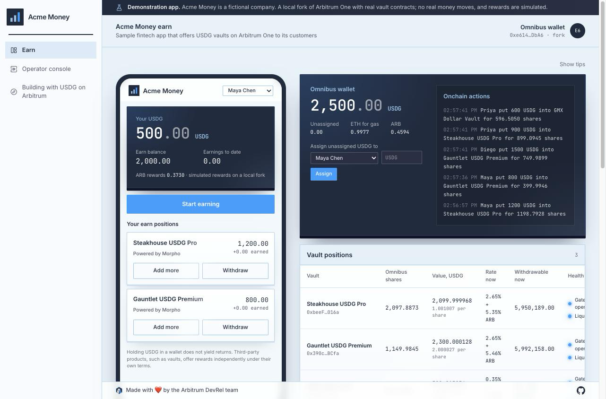
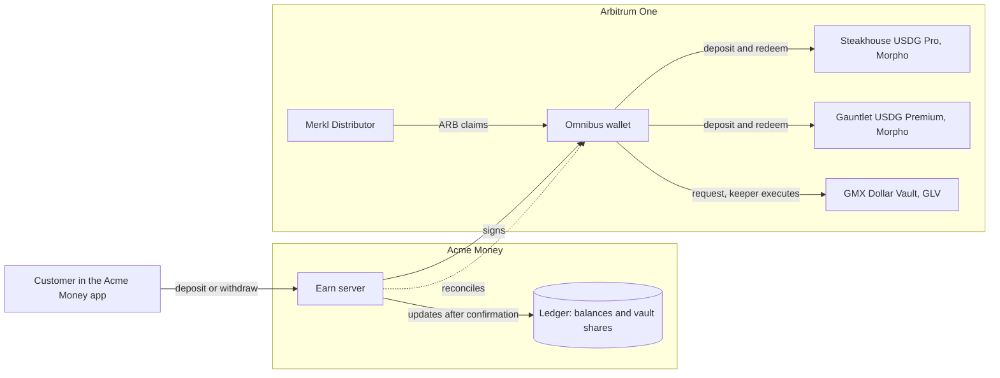

# Sample fintech earn

A simulated fintech app for a fictional company, Acme Money, that adds an Earn feature: its customers supply USDG to third party vaults on Arbitrum One, and Acme Money keeps the books. It shows how an app that already holds customer dollars can offer vault rates honestly, move customer money into and out of vaults from one wallet, keep a per customer ledger that always matches the chain, and share vault incentives fairly.

It uses the three USDG vaults on Arbitrum One that [DRIP](https://arbitrumdrip.com/opportunities), Arbitrum's DeFi Renaissance Incentive Program, incentivizes: two Morpho vaults curated by Steakhouse Financial and Gauntlet, and the GMX Dollar Vault.



> [!IMPORTANT]
> This is a demonstration app and unaudited example code. Use it to learn the integration, not to manage real funds as it is. Holding USDG in a wallet does not yield returns. Third party products, such as vaults, offer rewards independently under their own terms.

## Who it is for

Developers at fintechs, neobanks, payment apps, and wallets that hold customer balances and want to add an earn feature without building yield products themselves. After running it you will know how to:

- **Show** vault rates the honest way: the vault's own variable rate and its incentive boost, with the boost token and end date.
- **Deposit** customer USDG into ERC-4626 vaults and into GMX's request based vault, from one omnibus wallet.
- **Keep the books** per customer in vault shares, and prove every pass that they match the chain.
- **Collect** ARB incentives from Merkl and share them by how much each customer held, and for how long.
- **Handle** the hard cases: withdrawal liquidity limits, vault gates, async settlement, and campaigns that end.

## Run it locally

```bash
pnpm install
pnpm --filter sample-fintech-earn dev:fork
```

Fork mode needs no accounts or funds. It starts:

- a fresh Anvil fork of Arbitrum One, so every deposit and withdrawal runs against the real vault contracts
- a local GMX keeper that executes GLV requests with live signed prices, as GMX's keepers do on mainnet
- a local stand in for Merkl that accrues simulated ARB rewards and posts real reward roots to the Merkl contract on the fork
- the app at http://127.0.0.1:3000

The page shows a customer's phone next to Acme Money's operator console. Add demo USDG to a customer, pick a vault, and deposit: the deposit flies to its vault on the console, and the books update once the chain confirms. A short tour walks you through each part the first time; hover any part to see what it does and which calls it makes. The first GMX deposit after startup can take a little longer while the fork loads GMX's state.

Vault rates, boosts, and liquidity are read live from Arbitrum One, so they match what the vaults show today.

The **Building with USDG on Arbitrum** page in the app's navigation walks through the ways businesses build with USDG and where to go next.

## How it works



### The vaults

| Vault                 | Protocol | Address                                      | How it settles                                      |
| :-------------------- | :------- | :------------------------------------------- | :-------------------------------------------------- |
| Steakhouse USDG Pro   | Morpho   | `0xbeeFf72B77e7584a450E887125F25E8D8819016a` | In the same transaction (ERC-4626)                  |
| Gauntlet USDG Premium | Morpho   | `0x390c1bb01F3F627144a40617e287d4cE3D5aBCfa` | In the same transaction (ERC-4626)                  |
| GMX Dollar Vault      | GMX      | `0x4Cd5A94a30876320ac65F2e192493EE476f13866` | A request a GMX keeper executes a few seconds later |

All three sit behind one adapter interface (`src/server/vaults/types.ts`): read state, preflight, deposit, withdraw, and settle. A deposit returns either a settled result or a pending request, and settle reports the exact shares the vault minted or burned, read from the chain.

**Morpho Vault V2** is ERC-4626 with a few things to know:

- Shares have 18 decimals and are worth more than one USDG each, so the app always converts with `previewWithdraw` and `previewRedeem`.
- `maxDeposit` and `maxWithdraw` always return zero by design. The app reads withdrawable liquidity from the Morpho API instead.
- A withdrawal larger than the vault's idle funds plus its liquidity market reverts, so the app checks liquidity before sending and tells the customer how much can come out now.
- Gates can switch on at any time, so `canReceiveShares`, `canSendAssets`, `canSendShares`, and `canReceiveAssets` are checked before every action.

**GMX GLV** is not ERC-4626. A deposit is one `GlvRouter.multicall` that sends the keeper fee, sends USDG, and creates the request. A keeper executes it with signed oracle prices, and GMX reports the result through its EventEmitter as `GlvDepositExecuted` or `GlvDepositCancelled`. The app keeps the action pending until then, so the customer's balance never changes before the vault does. A cancelled request returns the funds, and the app shows GMX's reason. GLV is liquidity for GMX perpetual markets, so its value moves with traders' profits and losses; the disclosure says so.

### Rates and boosts

Each vault shows two numbers, never one blended figure on its own:

- **The vault rate** comes from the protocol that runs the vault: Morpho's `netApyExcludingRewards`, and GMX's GLV APY.
- **The boost** comes from the live DRIP campaign on Merkl, with its reward token and end date. On the Morpho vaults the boost is ARB that the holder of the vault shares claims from Merkl. On the GMX vault the boost is paid into the GLV price, so there is nothing to claim.

Campaigns end and new ones start. When no campaign is live, a vault simply shows its own rate.

### Choosing a custody model

This sample uses one **omnibus wallet**: Acme Money holds every customer's vault shares in a single wallet and keeps each customer's share in its own ledger. That is how custodial apps already treat customer balances, and it puts the interesting work in your code: share accounting, reward sharing, and reconciliation.

The alternative is **one wallet per customer**, for example through an embedded wallet provider. Then the chain is the ledger, Merkl credits rewards to each customer directly, and customers sign their own deposits (USDG supports EIP-2612 permits, so a deposit can be one signature and one transaction). Choose based on who holds custody in your product today.

### What to tell customers

Before a customer's first deposit into each vault, the app shows what they are agreeing to and asks them to accept it:

- Rates are variable and not guaranteed.
- Boosts are temporary third party incentives, shown with their token and end date, and they can end.
- The vault is run by a third party, not by Acme Money.
- Withdrawals are usually instant, but can be delayed when a vault lacks liquidity.
- Customers can lose money.
- Holding USDG alone earns nothing.

Vault specific lines cover curators and fees for Morpho, and trader profit and loss, the withdrawal fee, and settlement timing for GMX. Morpho vault screens carry "Powered by Morpho".

### Keeping the books

Every pass, the app checks three rules and shows each one with both numbers side by side:

1. For each vault, the customers' shares in the ledger add up to the omnibus wallet's shares onchain.
2. The omnibus wallet holds at least the USDG the ledger owes customers. Anything above that is unassigned, and the operator can assign it to a customer.
3. ARB shared with customers never exceeds ARB claimed, and the wallet still holds it.

Customer actions are serialized, so each share delta belongs to exactly one customer. Actions waiting on the chain are stored, so a GMX request that finishes while the app is down is settled once when it comes back.

### Sharing rewards

Merkl credits the Morpho boost to the omnibus wallet. When the operator claims, the app splits the newly claimed ARB across vaults using Merkl's per vault breakdown, then splits each vault's part across customers by share-seconds: shares held multiplied by time held, from the ledger's share history. Each customer gets their share rounded down, and the remainder carries into the next claim, so nothing is handed out twice.

## What fork mode simulates

- **The GMX keeper.** No keepers watch a local fork, so a local one impersonates a GMX keeper account and submits live signed prices from GMX's public API. It waits for prices newer than each request, as mainnet keepers do.
- **Merkl rewards.** Merkl never computes rewards for a fork, so a local service accrues ARB on the omnibus wallet's Morpho positions at the live campaign rate on a sped up clock (one demo minute counts as one day), builds real Merkle trees, and posts their roots to the real Distributor contract on the fork. The app's claim runs against the real contract with real proofs. Every rewards figure in fork mode is labeled as simulated.
- **Funding.** Demo USDG moves from a large holder on the fork into the omnibus wallet.

Everything else, from vault contracts to share prices, gates, and the Merkl Distributor, is real Arbitrum One code and state.

## Run it on Arbitrum One

Running on mainnet moves real funds, at your own risk. Copy `app/.env.example` to `app/.env`, set `OMNIBUS_PRIVATE_KEY` and `RPC_URL`, then:

```bash
pnpm --filter sample-fintech-earn build
pnpm --filter sample-fintech-earn start
```

Send USDG to the omnibus wallet (the [sample business treasury](../sample-business-treasury) shows how to mint it from USD with Paxos), then use **Assign** on the console to credit it to a customer. The omnibus wallet also needs a little ETH for gas and GMX keeper fees. Rewards come from the real Merkl API.

## Configuration

| Variable              | Purpose                                                             |
| :-------------------- | :------------------------------------------------------------------ |
| `MODE`                | `mainnet` (fork mode is set by `pnpm dev:fork`)                     |
| `OMNIBUS_PRIVATE_KEY` | The wallet that holds every customer's vault shares                 |
| `RPC_URL`             | Arbitrum One RPC endpoint                                           |
| `MERKL_API_URL`       | Merkl API (fork mode points this at the local stand in)             |
| `MORPHO_API_URL`      | Morpho API, for vault rates and withdrawable liquidity              |
| `GMX_API_URL`         | GMX API, for the GLV price, markets, and rate                       |
| `FORK_RPC_URL`        | Upstream RPC for the fork (defaults to the public Arbitrum One RPC) |
| `LOOP_INTERVAL_MS`    | How often the earn loop runs (default 5000)                         |
| `DB_PATH`             | Where the app keeps its records (default `earn.db`)                 |

## Code map

```text
app/
├── scripts/
│   ├── dev-fork.ts        One command local mode
│   ├── stack.ts           Starts the fork, the keeper, the Merkl stand in, and the app
│   ├── probe.ts           Checks every contract call and API the app depends on, on a fork
│   └── markets.ts         Prints the live vault data
└── src/
    ├── server/
    │   ├── vaults/        The adapter interface, Morpho Vault V2, and GMX GLV
    │   ├── market.ts      Live rates, boosts, TVL, and liquidity
    │   ├── money.ts       Deposits, withdrawals, settlement, funding, and assignment
    │   ├── ledger.ts      Customer balances, positions, and share history
    │   ├── reconcile.ts   The three bookkeeping rules
    │   ├── rewards.ts     Merkl reads, claims, and time weighted sharing
    │   └── loop.ts        The earn loop and live state stream
    ├── app/               Pages and API routes
    └── components/        The customer phone, the console, tips, and the tour
fork-services/             The local GMX keeper, the Merkl stand in, and fork helpers
e2e/                       End to end tests for the whole stack
```

## Tests

```bash
pnpm --filter sample-fintech-earn test        # ledger, reconciliation, and reward sharing
pnpm --filter sample-fintech-earn-e2e test    # the whole stack on a fresh fork
```

## Before you build on it

- Keep the omnibus key in a key management service or custody provider, not an environment variable.
- Put the app and its API behind your own authentication, and add your own customer onboarding.
- Review each vault's terms, and the incentive program's terms, before offering it to customers.
- Have the code reviewed and audited for your use case.
