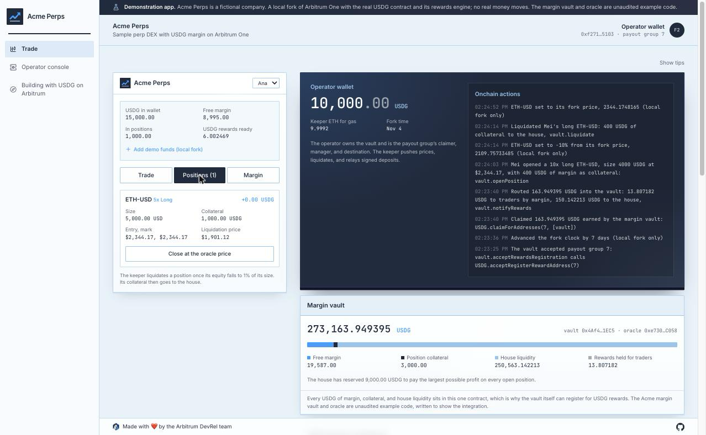
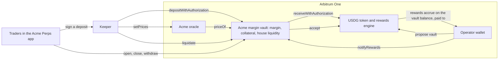

# Sample perp DEX

A simulated perp DEX for a fictional company, Acme Perps, that takes USDG as margin on Arbitrum One. It shows how a perp exchange can hold every trader's USDG in one margin vault, take deposits with a single signature, register that vault for the USDG rewards built into the token, and share those rewards with traders.



> [!IMPORTANT]
> This is a demonstration app and unaudited example code, including the margin vault and oracle contracts. Use it to learn the integration, not to manage real funds as it is. Holding USDG in a wallet does not yield returns. The USDG rewards in this sample are Global Dollar Network partner rewards that accrue to a Paxos partner under its agreement, at rates Paxos sets and can change.

## Who it is for

Developers on perp DEX teams, and protocols adding a margin product, who want to accept USDG as margin. After running it you will know how to:

- **Hold** USDG margin in a vault your protocol owns, where positions are bookkeeping and collateral never leaves.
- **Deposit** with one EIP-3009 signature that your backend relays, and why the vault checks its balance after the call.
- **Register** the margin vault for USDG rewards through the propose and accept flow, and why the vault itself makes the accept call.
- **Share** the rewards the vault earns between traders and the house by balance, with books that match the chain.

## Run it locally

```bash
pnpm install
pnpm --filter sample-perp-dex dev:fork
```

Fork mode needs no accounts or funds. It starts:

- a fresh Anvil fork of Arbitrum One, so every call runs against the real USDG token and its rewards engine
- the Acme oracle and margin vault, listing ETH-USD and BTC-USD at the Chainlink price, with 250,000 USDG of house liquidity
- two demo traders already in positions, and a third with USDG in her wallet only
- a payout group for Acme Perps, created by a local stand in for Paxos onboarding
- the app at http://127.0.0.1:3000 (set `PORT` to use another port)

The page shows the Acme Perps app next to its operator console. Deposit margin with one signature as Mei and open a position. On the console, propose the vault, accept from the vault, advance the fork clock, and claim and route its rewards: traders see them on the Margin tab. Move a market down 10% and watch the keeper liquidate a 10x long. A short tour walks you through each part the first time; hover any part to see what it does and which calls it makes.

The **Building with USDG on Arbitrum** page in the app's navigation walks through the ways businesses build with USDG and where to go next.

## How it works



### Margin in one vault

`AcmeMarginVault` (`contracts/src/AcmeMarginVault.sol`) holds every USDG the exchange has: each trader's free margin, the collateral behind open positions, and the house liquidity that takes the other side. A position is a record in the vault, not a transfer:

- **Open** moves collateral from free margin to the position and charges a 0.10% fee to the house. The house reserves the position's largest possible profit, its size, so it can always pay.
- **Close** settles at the oracle price. Collateral plus profit, or minus loss, less a 0.10% fee returns to free margin; the house pays or keeps the difference.
- **Liquidate** is open to anyone once a position's equity falls to 1% of its size. The remaining collateral goes to the house.

Because nothing leaves the vault, its USDG balance always equals free margin plus collateral plus house liquidity plus rewards waiting for traders. The engine is deliberately small: isolated positions, one per trader per market, up to 10x, with no funding or borrow fees, limit orders, or liquidation rewards.

### Deposits with one signature

USDG supports EIP-3009 signed transfers. The trader signs a `ReceiveWithAuthorization` naming the vault as the recipient, with the USDG domain (`name` "Global Dollar", `version` "1", the chain id, and the USDG address). Acme's keeper submits it, so the trader needs no ETH for gas:

1. The trader signs `ReceiveWithAuthorization(from, to = vault, value, validAfter, validBefore, nonce)` with a random 32 byte nonce.
2. The keeper calls `vault.depositWithAuthorization(from, value, validAfter, validBefore, nonce, signature)`.
3. The vault calls `USDG.receiveWithAuthorization`, which only the named recipient may call, so nobody can front run the signature into a plain transfer.
4. The vault checks that its USDG balance rose by exactly `value`, then credits the signer.

The balance check matters. When a nonce has already been used, USDG emits `AuthorizationAlreadyUsed` and returns without reverting or moving funds. A vault that credited margin whenever the call returned would let anyone replay an old signature into free margin. Acme's vault reverts with `DepositNotReceived` instead.

### Prices and the keeper

`AcmeOracle` (`contracts/src/AcmeOracle.sol`) holds a price per market that only the keeper can push. The vault reads `priceOf(market)`, which reverts once a price is older than 120 seconds, so trading pauses rather than running on a stale price. The keeper is part of Acme's backend: every few seconds it pushes prices that are 30 seconds old or have changed, and liquidates any position for which `vault.isLiquidatable(trader, market)` is true. A production perp would put Chainlink Data Streams, Pyth, or its own signed prices behind the same interface.

### Registering the vault for USDG rewards

USDG on Arbitrum has a rewards engine built into the token. Paxos places partner addresses into payout groups, and a registered address accrues rewards on its USDG balance at the rate Paxos sets for the group. Every transfer updates a registered address's share, so the vault's rewards follow its balance as traders deposit and withdraw. Contracts join in two onchain steps:

1. The group's manager or claimer calls `USDG.proposeRegisterRewardAddress(payoutGroupId, vault)`.
2. The vault calls `USDG.acceptRegisterRewardAddress(payoutGroupId)` itself.

In `AcmeMarginVault` the owner calls `acceptRewardsRegistration(payoutGroupId)`, and the vault forwards the call to USDG. This works because the vault holds all of the margin. Perp designs that keep collateral in contracts with no way to make an arbitrary call, such as GMX v2's market tokens, cannot register through this flow.

Paxos documents the contract interface in [paxos-token-contracts](https://github.com/paxosglobal/paxos-token-contracts/blob/master/docs/CLAIMABLE_REWARDS_README.md), and the [Rewards Engine guides](https://docs.paxos.com/guides/developer/rewards-engine) cover payout groups and partner access.

### Sharing rewards with traders

Rewards accrue to the vault, but a claim pays the payout group's destination, here Acme's operator wallet. The console routes them back:

1. Read `USDG.availableRewardsOf(vault)`.
2. Claim with `USDG.claimForAddresses(payoutGroupId, [vault])`, and take the exact amount from the USDG `Transfer` to the operator in the receipt.
3. Call `vault.notifyRewards(amount)`.

`notifyRewards` splits the amount by balance at that moment. The house liquidity's share joins the house liquidity. The rest is spread per unit of trader margin, counting free margin and position collateral alike, since both earned while they sat in the vault. Each trader's rewards settle before any change to their margin, so a deposit after a route never shares in it. Traders add their rewards to free margin with `vault.claimRewards()`, then trade with them or withdraw. Routing often keeps the split close to a time weighted one.

### Keeping the books

Every pass, the console checks these rules and shows each one with both numbers:

1. The vault's USDG balance covers free margin, collateral, house liquidity, and rewards held for traders. Anything above that, such as a direct transfer, shows as extra.
2. Each trader's free margin, read one by one, adds up to the vault's total.
3. Each open position's collateral adds up to the vault's total.
4. House liquidity covers the profit reserved for open positions.
5. The claims in Acme's records match the `RewardsClaimed` events the USDG contract emitted for the vault.
6. Everything claimed was routed into the vault, as its `RewardsNotified` events show.

Positions, deposits, and liquidations are read from the vault and its events every pass, so a restart loses nothing.

## What fork mode simulates

- **Paxos onboarding.** Paxos creates payout groups for its partners. On the fork, a stand in impersonates the Paxos registrar account to create one with the operator as claimer, manager, and destination. Everything after that, from propose and accept to accrual and claims, is the real USDG contract.
- **Market prices.** The keeper prices each market from its Chainlink feed on the fork, which stays at its value at the fork block. The console can move a market up or down to show PnL and liquidations.
- **Time.** Rewards accrue with block time, so the console can move the fork clock forward by a day, a week, or a month. The keeper pushes fresh prices right after.
- **Funding.** Demo ETH and USDG come from holders on the fork.

## Going to production

- Talk to Paxos about Global Dollar Network partner access. Create the payout group in the Paxos Dashboard or with `POST /v2/rewards/payout-groups`, and read its `onchain_group_id` for the propose and accept calls.
- Keep the manager, claimer, and keeper keys in a key management service or custody provider.
- Use a production price source with deviation checks, add funding and borrow fees, and pay liquidators.
- Have your vault reviewed and audited, including its rewards accounting and the deposit balance check.

## Configuration

`pnpm dev:fork` sets every value. They are listed in `app/.env.example`.

| Variable               | Purpose                                                             |
| :--------------------- | :------------------------------------------------------------------ |
| `RPC_URL`              | The Arbitrum One fork                                               |
| `OPERATOR_PRIVATE_KEY` | Owns the vault and oracle; claimer, manager, and destination        |
| `KEEPER_PRIVATE_KEY`   | Pushes prices, liquidates, and relays signed deposits               |
| `WALLET_KEYS`          | The demo traders' keys, as JSON                                     |
| `VAULT_ADDRESS`        | The margin vault                                                    |
| `ORACLE_ADDRESS`       | The oracle                                                          |
| `PAYOUT_GROUP_ID`      | Acme Perps' payout group                                            |
| `START_BLOCK`          | Where the app starts reading the vault's events                     |
| `FORK_RPC_URL`         | Upstream RPC for the fork (defaults to the public Arbitrum One RPC) |
| `LOOP_INTERVAL_MS`     | How often the app runs the keeper and reads the fork (default 3000) |
| `DB_PATH`              | Where the app keeps its records (default `perp.db`)                 |

## Code map

```text
contracts/
├── src/AcmeMarginVault.sol   Margin, positions, house liquidity, rewards per unit of margin, and the accept call
├── src/AcmeOracle.sol        Keeper pushed prices with a staleness limit
└── test/                     Trading math, signed deposits and replays, reward sharing, and a fuzzed books invariant
app/
├── scripts/
│   ├── dev-fork.ts           One command local mode
│   ├── stack.ts              Starts the fork, deploys the vault, seeds traders, and starts the app
│   ├── setup.ts              Deploys the oracle and vault and prices the markets
│   └── probe.ts              Checks every contract call the app depends on, on a fresh fork
└── src/
    ├── server/
    │   ├── authorize.ts      Signs a trader's EIP-3009 deposit
    │   ├── margin.ts         Deposits, withdrawals, and rewards added to margin
    │   ├── trade.ts          Opening and closing positions
    │   ├── keeper.ts         Price pushes and liquidations
    │   ├── rewards.ts        Propose, accept, claim, and route
    │   ├── reconcile.ts      The bookkeeping rules
    │   └── snapshot.ts       Everything the two views show
    ├── lib/math.ts           Fees, PnL, and liquidation prices, mirrored from the vault
    ├── app/                  Pages and API routes
    └── components/           The trader app, the console, tips, and the tour
fork-services/                Fork helpers and the payout group stand in
e2e/                          End to end tests for the whole stack
```

## Tests

```bash
pnpm --filter @arbitrum-usdg/perp-dex-contracts test   # the vault and oracle (Foundry)
pnpm --filter sample-perp-dex test                     # position math, reconciliation, refusals, and copy
pnpm --filter sample-perp-dex-e2e test                 # the whole stack on a fresh fork
```

The contract tests need [Foundry](https://book.getfoundry.sh/getting-started/installation).
