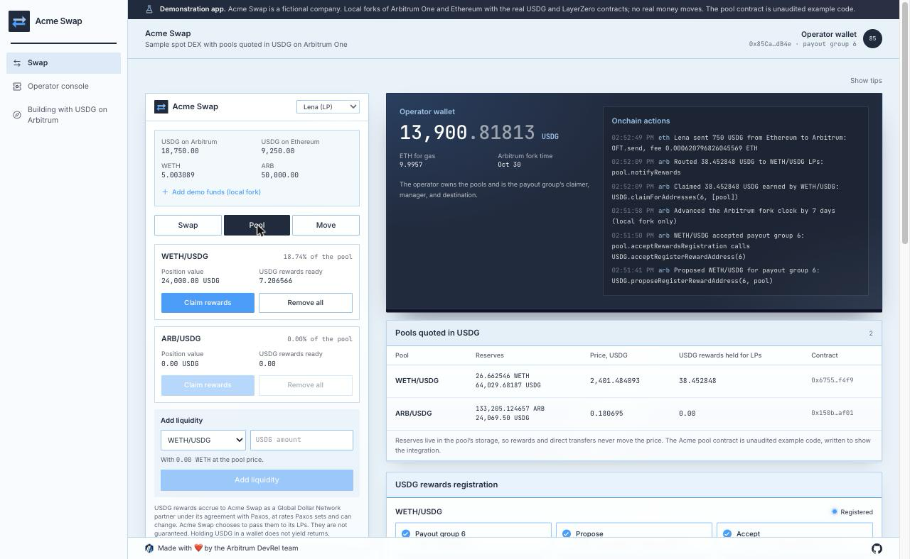
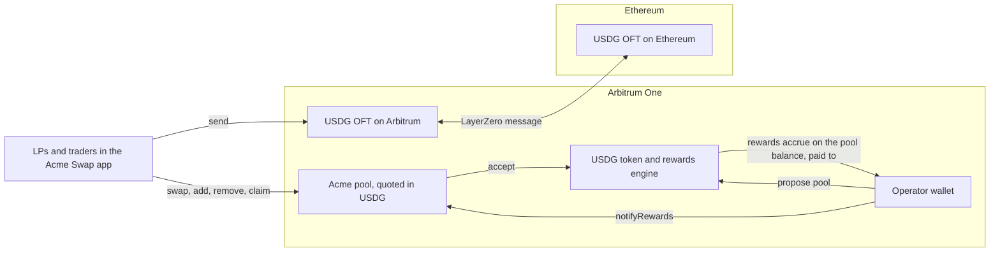

# Sample spot DEX

A simulated spot DEX for a fictional company, Acme Swap, that uses USDG as its quote asset on Arbitrum One. It shows how a DEX can price every pool in USDG, register its pool contracts for the USDG rewards built into the token, pass those rewards to its liquidity providers, and move USDG between Ethereum and Arbitrum with LayerZero.



> [!IMPORTANT]
> This is a demonstration app and unaudited example code, including the pool contract. Use it to learn the integration, not to manage real funds as it is. Holding USDG in a wallet does not yield returns. The USDG rewards in this sample are Global Dollar Network partner rewards that accrue to a Paxos partner under its agreement, at rates Paxos sets and can change.

## Who it is for

Developers on DEX and AMM teams, and protocols that run their own pools, who want to list USDG as a quote asset. After running it you will know how to:

- **Quote** pools in USDG, with reserves kept apart from any reward balance.
- **Register** a pool contract for USDG rewards through the propose and accept flow, and why the pool itself makes the accept call.
- **Route** the rewards a pool earns to its LPs by LP balance over time, with books that match the chain.
- **Move** USDG between Ethereum and Arbitrum through the Paxos LayerZero OFT, and track each transfer by its guid.

## Run it locally

```bash
pnpm install
pnpm --filter sample-spot-dex dev:fork
```

Fork mode needs no accounts or funds. It starts:

- fresh Anvil forks of Arbitrum One and Ethereum, so every call runs against the real USDG token, its rewards engine, and the Paxos OFT contracts
- two Acme pools, WETH/USDG and ARB/USDG, deployed and seeded at the Chainlink price, with two demo LPs already in them
- a payout group for Acme Swap, created by a local stand in for Paxos onboarding
- a local relay that delivers LayerZero messages between the two forks
- the app at http://127.0.0.1:3000 (set `PORT` to use another port)

The page shows the Acme Swap app next to its operator console. Swap with a demo wallet, then on the console propose a pool, accept from the pool, advance the fork clock, and claim and route its rewards: the LPs' rewards appear on the Pool tab. On the Move tab, send USDG from Ethereum to Arbitrum and watch it land. A short tour walks you through each part the first time; hover any part to see what it does and which calls it makes.

The **Building with USDG on Arbitrum** page in the app's navigation walks through the ways businesses build with USDG and where to go next.

## How it works



### Pools quoted in USDG

`AcmePool` (`contracts/src/AcmePool.sol`) is a constant product pool with a 0.30% fee to LPs. Every pool pairs one token with USDG, so prices read in dollars. Two choices make it safe to hold rewards:

- **Reserves live in storage.** Pricing never reads `balanceOf`, so USDG sent to the pool directly, or rewards waiting for LPs, cannot move the price.
- **The LP token tracks rewards.** `notifyRewards(amount)` adds USDG rewards per LP token, and every transfer, mint, and burn settles what each holder has earned first. An LP who moves their LP tokens keeps what they earned until then.

### Registering a pool for USDG rewards

USDG on Arbitrum has a rewards engine built into the token. Paxos places partner addresses into payout groups, and a registered address accrues rewards on its USDG balance at the rate Paxos sets for the group. Contracts that cannot sign, such as pools, join in two onchain steps:

1. The group's manager or claimer calls `USDG.proposeRegisterRewardAddress(payoutGroupId, pool)`.
2. The pool calls `USDG.acceptRegisterRewardAddress(payoutGroupId)` itself.

The second step is why a pool needs its own function for it. In `AcmePool` the owner calls `acceptRewardsRegistration(payoutGroupId)`, and the pool forwards the call to USDG. This works because each Acme pool holds its own reserves. Designs where one shared contract holds every pool's tokens, as in Uniswap v4's PoolManager, cannot register a single pool this way.

Paxos documents the contract interface in [paxos-token-contracts](https://github.com/paxosglobal/paxos-token-contracts/blob/master/docs/CLAIMABLE_REWARDS_README.md), and the [Rewards Engine guides](https://docs.paxos.com/guides/developer/rewards-engine) cover payout groups and partner access.

### Routing rewards to LPs

Rewards accrue to the pool, but a claim pays the payout group's destination, here Acme Swap's operator wallet. The console passes them on:

1. Read `USDG.availableRewardsOf(pool)`.
2. Claim that pool alone with `USDG.claimForAddresses(payoutGroupId, [pool])`, and take the exact amount from the USDG `Transfer` to the operator in the receipt. Claiming one pool at a time makes every claim attributable to one pool.
3. Call `pool.notifyRewards(amount)`, which shares it across the pool's LPs by LP balance.

If routing fails after a claim, the next route sends the leftover first, so claimed and routed always meet again. A DEX could keep a protocol share before routing; this sample routes everything.

### Moving USDG across chains

USDG is native on each chain, and Paxos runs a LayerZero OFT beside it that burns USDG on the source chain and mints the same amount on the destination. The addresses are on the [Paxos USDG mainnet page](https://docs.paxos.com/guides/stablecoin/usdg/mainnet):

| Chain        | OFT                                          | LayerZero endpoint id |
| :----------- | :------------------------------------------- | :-------------------- |
| Arbitrum One | `0xC3274Ec3f772D8534575EaAd5231cf250a48b6b6` | 30110                 |
| Ethereum     | `0x147BdE4F997f0d4C7544ED0C55eAcf1E5E6bf9c4` | 30101                 |

A send is two calls on the source OFT, with no approval needed because the OFT burns USDG directly:

1. `quoteSend(sendParam, false)` returns the LayerZero fee in ETH.
2. `send(sendParam, fee, refundAddress)` with the fee as the transaction value. It emits `OFTSent` with the message's guid.

On the destination, `OFTReceived` with the same guid marks delivery. The app rebuilds its transfer list from these two events every pass, so a transfer in flight while the app restarts still completes on screen. Paxos limits each direction to 25,000,000 USDG per day, and `getAmountCanBeSent(dstEid)` reports what is left. Arbitrum connects to Ethereum directly, and other chains go through Ethereum.

### Keeping the books

Every pass, the console checks these rules and shows each one with both numbers:

1. Each pool's USDG balance covers its quote reserve plus the rewards it holds for LPs. Anything above that, such as a direct transfer, shows as extra.
2. The claims in Acme Swap's records match the `RewardsClaimed` events the USDG contract emitted for the pool.
3. Everything claimed was routed into the pool, as its `RewardsNotified` events show.
4. Every transfer minted on the destination exactly what it burned on the source.

## What fork mode simulates

- **Paxos onboarding.** Paxos creates payout groups for its partners. On the fork, a stand in impersonates the Paxos registrar account to create one with the operator as claimer, manager, and destination. Everything after that, from propose and accept to accrual and claims, is the real USDG contract.
- **LayerZero delivery.** On a live network, DVNs verify each message and an executor delivers it. On the forks, a local relay watches `PacketSent`, waits a few seconds, and delivers the message to the destination OFT as the LayerZero endpoint would. The OFT burns and mints exactly as on mainnet.
- **Time.** Rewards accrue with block time, so the console can move the Arbitrum fork clock forward by a day, a week, or a month.
- **Funding.** Demo ETH, USDG, WETH, and ARB come from holders on the forks.

## Going to production

- Talk to Paxos about Global Dollar Network partner access. Create the payout group in the Paxos Dashboard or with `POST /v2/rewards/payout-groups`, and read its `onchain_group_id` for the propose and accept calls.
- Keep the manager and claimer keys in a key management service or custody provider.
- Have your pool contract reviewed and audited, including its rewards accounting.
- Track live LayerZero transfers by guid on [LayerZero Scan](https://layerzeroscan.com).

## Configuration

`pnpm dev:fork` sets every value. They are listed in `app/.env.example`.

| Variable               | Purpose                                                               |
| :--------------------- | :-------------------------------------------------------------------- |
| `RPC_URL`              | The Arbitrum One fork                                                 |
| `ETH_RPC_URL`          | The Ethereum fork                                                     |
| `OPERATOR_PRIVATE_KEY` | Owns the pools; claimer, manager, and destination of the payout group |
| `WALLET_KEYS`          | The demo wallets' keys, as JSON                                       |
| `POOL_WETH`            | The WETH/USDG pool                                                    |
| `POOL_ARB`             | The ARB/USDG pool                                                     |
| `PAYOUT_GROUP_ID`      | Acme Swap's payout group                                              |
| `FORK_RPC_URL`         | Upstream RPC for the Arbitrum fork (defaults to the public RPC)       |
| `ETH_FORK_RPC_URL`     | Upstream RPC for the Ethereum fork (defaults to a public RPC)         |
| `LOOP_INTERVAL_MS`     | How often the app reads both forks (default 3000)                     |
| `DB_PATH`              | Where the app keeps its records (default `dex.db`)                    |

## Code map

```text
contracts/
├── src/AcmePool.sol       The pool, its LP token, rewards per LP token, and the accept call
└── test/AcmePool.t.sol    Swap math, reward sharing across transfers, and the owner gate
app/
├── scripts/
│   ├── dev-fork.ts        One command local mode
│   ├── stack.ts           Starts both forks, deploys the pools, and starts the relay and app
│   ├── setup.ts           Deploys and seeds pools at the Chainlink price
│   └── probe.ts           Checks every contract call the app depends on, on fresh forks
└── src/
    ├── server/
    │   ├── trade.ts       Swaps and liquidity
    │   ├── rewards.ts     Propose, accept, claim, and route
    │   ├── bridge.ts      Quotes, sends, and transfers rebuilt from OFT events
    │   ├── reconcile.ts   The bookkeeping rules
    │   └── snapshot.ts    Everything the two views show
    ├── app/               Pages and API routes
    └── components/        The trader app, the console, tips, and the tour
fork-services/             Fork helpers, the payout group stand in, and the LayerZero relay
e2e/                       End to end tests for the whole stack
```

## Tests

```bash
pnpm --filter @arbitrum-usdg/spot-dex-contracts test   # the pool contract (Foundry)
pnpm --filter sample-spot-dex test                     # reconciliation, refusals, and copy
pnpm --filter sample-spot-dex-e2e test                 # the whole stack on fresh forks
```

The contract tests need [Foundry](https://book.getfoundry.sh/getting-started/installation).
